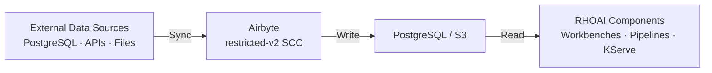
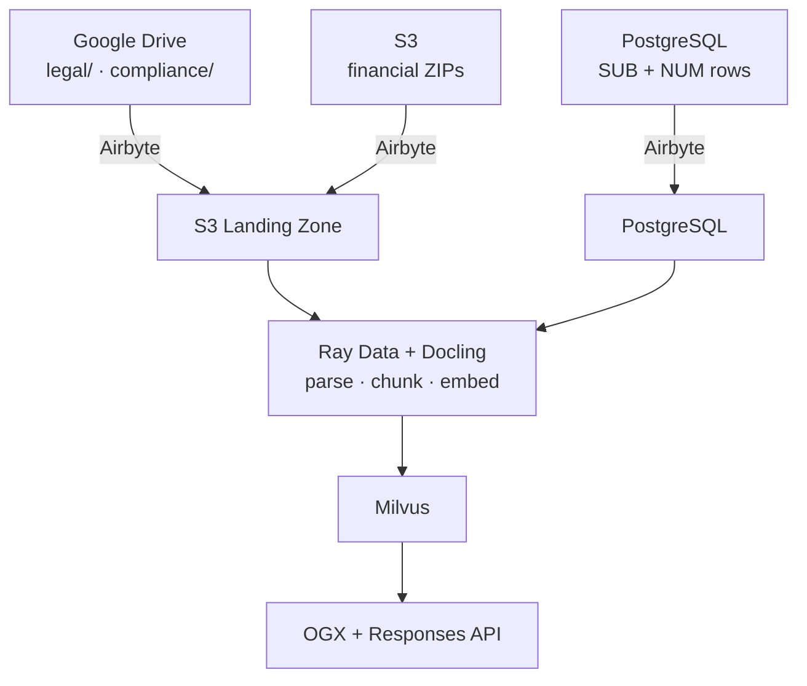

# Airbyte on OpenShift AI -- Partner Validation

**Verdict: CONDITIONAL PASS**

Airbyte 2.1.1 deploys and operates on OpenShift 4.21 alongside Red Hat OpenShift AI (RHOAI) 3.4.1 with one critical workaround required. All core platform pods run under the `restricted-v2` SCC without elevated privileges. End-to-end data ingestion was validated with 72 rows synced across 3 tables from PostgreSQL source to PostgreSQL destination. Airbyte is not yet Red Hat certified (preflight and chart-verifier both fail), and the replication orchestrator has a high-severity resource bug that requires manual intervention on resource-constrained clusters.

Report date: 2026-08-27 (Phase 1), 2026-10-29 (Phase 2 in progress)

---

## Overview

This repository documents the validation of [Airbyte](https://airbyte.com) as a data integration partner for Red Hat OpenShift AI (RHOAI). The validation is structured in two phases:

- **Phase 1 (complete):** Platform validation -- deployment, SCC compliance, RHOAI coexistence, end-to-end PostgreSQL sync, and certification readiness.
- **Phase 2 (in progress):** Counterparty Due Diligence scenario -- a realistic multi-source RAG pipeline using SEC EDGAR filings, Ray Data + Docling for document processing, Milvus for vector search, and OGX for chat.

### Phase 1 — Platform Validation

- **Deployment** on OpenShift 4.21.16 via Helm chart
- **Security compliance** with the `restricted-v2` Security Context Constraint
- **Coexistence** with RHOAI 3.4.1 (zero conflicts across 22 RHOAI pods)
- **End-to-end data ingestion** from PostgreSQL source to PostgreSQL destination
- **Red Hat certification readiness** via preflight and chart-verifier
- **Integration patterns** with RHOAI components (Workbenches, Pipelines, KServe)

### Phase 2 — Counterparty Due Diligence

A scenario where an enterprise risk team uses Airbyte to ingest counterparty data from multiple sources, then processes and queries it through an RHOAI-powered RAG pipeline. The scenario validates Airbyte's role as the ingestion layer in a production-like AI workflow.

**Data sources** (seeded from SEC EDGAR public filings):

| Source | Content | Landing Zone |
|--------|---------|-------------|
| Google Drive `legal/` | EX-10 commercial agreement exhibits | Airbyte → S3 / object storage |
| Google Drive `compliance/` | 10-K, 10-Q, 8-K filings | Airbyte → S3 / object storage |
| S3 `financial-statements/` | Quarterly Financial Statement Data Set ZIPs | Airbyte → S3 / object storage |
| PostgreSQL | SUB (submissions) + NUM (financial facts) rows | Airbyte → PostgreSQL |

**RHOAI pipeline stack:**

| Component | Role |
|-----------|------|
| **Ray Data + Docling** | Document parsing (HTML → structured text), chunking, embedding |
| **Milvus** | Vector store (COSINE similarity, IVF_FLAT indexing) |
| **OGX + Responses API** | RAG chat interface (first milestone) |
| **AutoRAG** | Retrieval optimization (follow-on test) |
| **RHOAI 3.5** | Target platform; migrate to 3.6 when GA for Data Connect Hub + Data Registry |

| Component | Phase 1 | Phase 2 (target) |
|-----------|---------|-------------------|
| OpenShift | 4.21.16 (Kubernetes 1.34.7) | TBD |
| RHOAI | 3.4.1 | 3.5 (migrate to 3.6 for DCH) |
| Airbyte | 2.1.1 (Helm chart `airbyte-v2/airbyte`) | 2.1.1 |
| Vector store | — | Milvus |
| Document processing | — | Ray Data + Docling |
| RAG chat | — | OGX + Responses API |
| Namespace | `airbyte-validation` | `airbyte-validation` |

---

## Validation Status

| Category | Result | Notes |
|----------|--------|-------|
| Deployment on OpenShift | PASS | 10 pods Running/Completed; namespace annotation workaround required |
| restricted-v2 SCC Compliance | PASS | All pods run under restricted-v2; no custom SCCs needed |
| RHOAI Coexistence | PASS | 6/6 checks passed; zero conflicts; 22 RHOAI pods healthy |
| E2E Data Ingestion | PASS | 72 rows, 13,592 bytes, 3m 13s; replication resource workaround required |
| Preflight (container image) | FAIL | 7 pass / 3 fail (missing /licenses, required labels, not UBI-based) |
| Chart-Verifier (Helm chart) | FAIL | 8 pass / 5 fail / 1 skipped (missing values.schema.json, kubeVersion, certified images) |

**Conditional pass logic:** Airbyte is fully functional on OpenShift with RHOAI, but the overall verdict is CONDITIONAL because:

1. **One high-severity bug** -- the replication orchestrator ignores resource configuration and hardcodes 2 CPU / 2 Gi per container, causing scheduling failures on resource-constrained clusters. A manual workaround exists.
2. **Not yet Red Hat certified** -- container images are not UBI-based and the Helm chart is missing certification metadata. These are pre-certification gaps, not functional blockers.

---

## Architecture

Airbyte deploys in its own namespace alongside RHOAI with full namespace isolation. The platform pods handle orchestration, scheduling, and API serving. Connector pods (source, destination) are launched dynamically for each sync job and terminated on completion.



**Namespace isolation:** Airbyte runs in `airbyte-validation` with its own service accounts, RBAC, and resource quotas. RHOAI components remain in `redhat-ods-applications`. The two namespaces share no CRDs, service accounts, or cluster-scoped resources. Communication happens through the shared data layer (PostgreSQL accessed via in-cluster DNS).

**Platform pods (all under restricted-v2 SCC):**

| Pod | Role | Status |
|-----|------|--------|
| airbyte-server | API + UI (port 8001) | Running |
| airbyte-worker | Sync orchestration | Running |
| airbyte-workload-launcher | Launches connector pods | Running |
| airbyte-workload-api-server | Internal API | Running |
| airbyte-temporal | Workflow engine | Running |
| airbyte-cron | Scheduled tasks | Running |
| airbyte-manifest-server | Connector builder | Running |
| airbyte-db-0 | Bundled PostgreSQL | Running |
| airbyte-minio-0 | Bundled object storage | Running |
| airbyte-bootloader | DB migration (one-time) | Completed |

---

## Quick Start

See the **[Deployment Guide](docs/deployment-guide.md)** for full step-by-step instructions, OpenShift configuration reference, and production hardening recommendations.

Short version:

```bash
# 1. Create namespace (two-step for MCS annotation)
oc new-project airbyte-validation
oc annotate namespace airbyte-validation \
  openshift.io/sa.scc.uid-range="1000/1" \
  openshift.io/sa.scc.supplemental-groups="1000/1" --overwrite

# 2. Deploy
helm repo add airbyte-v2 https://airbytehq.github.io/charts
helm upgrade --install airbyte airbyte-v2/airbyte \
  --namespace airbyte-validation \
  --values helm/openshift-values.yaml \
  --version 2.1.1 --wait --atomic

# 3. Expose and verify
oc apply -f manifests/route.yaml -n airbyte-validation
oc get pods -n airbyte-validation
```

The `scripts/` directory contains full automation (`00-prereqs.sh` through `07-generate-report.py`).

---

## What Works

- **restricted-v2 SCC compliance** — All 10 platform pods run under `restricted-v2` without custom SCC grants. `runAsNonRoot: true`, UID 1000, all capabilities dropped.
- **RHOAI coexistence (6/6 passed)** — 22 RHOAI pods healthy, all 12 managed components unchanged, zero conflicts, no CRD overlap. Full report: [`reports/coexistence-check.txt`](reports/coexistence-check.txt)
- **E2E data ingestion** — 72 rows synced across 3 tables (3m 13s, PostgreSQL → PostgreSQL via Airbyte Public API). Full results: [`reports/sync-results.json`](reports/sync-results.json)
- **Low resource footprint** — ~205m CPU / ~2.2 GiB for all platform pods
- **No CRDs** — Airbyte uses only standard Kubernetes resources, eliminating CRD conflict risk

---

## Known Issues

| Finding | Severity | Summary |
|---------|----------|---------|
| Replication pod hardcoded resources | HIGH | Orchestrator ignores Helm resource config, hardcodes 2 CPU / 2 Gi per container. Workaround: patch pod spec manually. |
| Namespace MCS annotation | MEDIUM | Two-step namespace creation required (OpenShift behavior, not Airbyte). |
| API version change (V1 → Public V1) | LOW | V2 uses `/api/public/v1/`; old `/api/v1/` returns 404. |
| Temporal UI requires root | LOW | Keep `temporalUi.enabled: false`. |

Full details, workaround scripts, and remediation roadmap: **[Known Issues & Remediation](docs/known-issues.md)**

---

## Certification Status

Airbyte is **not yet Red Hat certified**. Preflight: 7 pass / 3 fail (missing `/licenses`, required labels, not UBI-based). Chart-verifier: 8 pass / 5 fail / 1 skipped (missing `values.schema.json`, `kubeVersion`, certified images). These are packaging gaps, not functional blockers.

Full results and certification steps: **[Certification Details](docs/certification.md)**

---

## Integration with OpenShift AI

Airbyte serves as the data ingestion layer that feeds enterprise data into RHOAI workloads. The counterparty due diligence scenario uses four Airbyte connections to land data from Google Drive, S3, and PostgreSQL into a shared landing zone, which RHOAI components then process into a searchable RAG pipeline.

### Data Flow



### RHOAI Components

| Component | Role | Status |
|-----------|------|--------|
| **Ray Data + Docling** | Batch document parsing (HTML → structured text), chunking, and embedding generation | In progress |
| **Milvus** | Vector store for embeddings (COSINE similarity, IVF_FLAT indexing) | Pending cluster setup |
| **OGX + Responses API** | RAG chat interface for counterparty queries | Planned (first milestone) |
| **AutoRAG** | Retrieval optimization and evaluation | Planned (follow-on test) |
| **Data Science Pipelines** | Orchestrate the end-to-end flow (Airbyte sync → Ray Data → Milvus → query) | Planned |
| **Data Connect Hub** | Manage data connections across the pipeline (RHOAI 3.6) | Deferred to 3.6 GA |

### Integration Patterns

- **Multi-source ingestion:** Airbyte syncs from Google Drive, S3, and PostgreSQL into a shared landing zone. Each source type uses a different Airbyte connector but lands in a consistent structure.
- **Document processing at scale:** Ray Data distributes Docling parsing across the cluster, handling HTML filings of varying sizes (3 KB to 14 MB).
- **Vector search:** Milvus stores embeddings with metadata (CIK, ticker, filing type, date) for filtered retrieval in counterparty queries.
- **In-cluster service discovery:** All components communicate via Kubernetes DNS. No external endpoints or load balancers needed between Airbyte, the landing zone, and RHOAI components.

### Seed Data

The initial platform validation used a small test dataset ([`data/seed.sql`](data/seed.sql)) with 72 rows across 3 tables (documents, metadata, customers) for the PostgreSQL-to-PostgreSQL sync test.

The counterparty due diligence scenario uses a much larger corpus seeded from SEC EDGAR — see [SEC EDGAR Seed Corpus](#sec-edgar-seed-corpus) for details.

---

## SEC EDGAR Seed Corpus

The `seed/` module downloads public filings from [SEC EDGAR](https://www.sec.gov/edgar) to populate the four source systems for the counterparty due diligence scenario. All data is publicly available; no API keys are required.

### Corpus Statistics (50 companies, full run)

| Category | Count | Size |
|----------|-------|------|
| Legal documents (EX-10 commercial agreements) | 144 | 44 MB |
| Compliance documents (10-K, 10-Q, 8-K) | 400 | 355 MB |
| Financial Statement Data Set ZIPs (8 quarters) | 8 | 909 MB |
| PostgreSQL SUB rows (submission metadata) | 397 | — |
| PostgreSQL NUM rows (financial facts) | 259,507 | 81 MB (SQL + TSV) |
| Seed manifest | 1 | 388 KB |

**Company selection:** 50 companies across 5 sectors (Technology, Financial Services, Healthcare, Industrials, Consumer) chosen for active SEC filing history and recognizability in demos. Tickers are configured in `seed/config.py`; CIKs and company names are resolved at runtime from SEC's `company_tickers.json`.

**Legal document filtering:** EX-10 exhibits are filtered for commercial agreements (vendor contracts, licenses, supply agreements) vs. compensation plans (stock awards, severance, bonus plans) using phrase matching. 9 of 50 companies had zero commercial agreements — primarily banks and pharma where EX-10 filings are predominantly compensation-related.

### Usage

SEC EDGAR requires a descriptive User-Agent. Set your org and email before running:

```bash
export EDGAR_ORG="Your Organization"
export EDGAR_EMAIL="you@example.com"
```

Run options:

```bash
make seed            # Full: 50 companies, 8 quarters (~13 min)
make seed-quick      # Quick test: 5 companies, no financial ZIPs (~1 min)
make seed-dry-run    # Discover filings without downloading

# Or directly with arguments:
python -m seed --companies 10 --max-legal 3 --max-compliance 5
python -m seed --skip-financial
```

Output goes to `data/seed/` (git-ignored):

```
data/seed/
├── drive/
│   ├── legal/          # EX-10 exhibits (HTML)
│   └── compliance/     # 10-K, 10-Q, 8-K filings (HTML)
├── s3/
│   └── financial-statements/  # Quarterly ZIP archives
├── postgres/
│   ├── financial_seed.sql     # CREATE TABLE + INSERT statements
│   ├── sub.tsv                # Submission rows (tab-separated)
│   └── num.tsv                # Financial fact rows (tab-separated)
└── manifests/
    └── seed-manifest.json     # Full provenance: source URIs, checksums, CIKs
```

### How It Works

1. **Resolve CIKs** — Fetches `company_tickers.json` from SEC to map tickers → CIK numbers (no hardcoded CIKs).
2. **Discover filings** — Queries EDGAR submissions API for each CIK, finds recent 10-K/10-Q/8-K filings and EX-10 exhibits.
3. **Download documents** — Rate-limited at 5 req/sec with retry on 429, 5xx, and connection drops. SEC enforces 10 req/sec but throttles aggressively near the limit.
4. **Download financial datasets** — Quarterly ZIP archives from SEC DERA (~110-125 MB each). SUB and NUM rows are filtered to target CIKs and written as PostgreSQL-ready SQL and TSV.
5. **Write manifest** — `seed-manifest.json` records every file's source URI, SHA-256 checksum, CIK, accession number, and filing metadata.

---

## Repository Structure

```
airbyte-openshift-validation/
|-- helm/
|   +-- openshift-values.yaml          # Helm values overlay for OpenShift restricted-v2
|-- manifests/
|   |-- namespace.yaml                 # Reference only -- use two-step creation
|   |-- postgresql.yaml                # PostgreSQL test data source deployment
|   +-- route.yaml                     # OpenShift Route for Airbyte server (port 8001, edge TLS)
|-- seed/                              # SEC EDGAR seed corpus generator (Phase 2)
|   |-- __main__.py                    # CLI entry point (make seed / python -m seed)
|   |-- config.py                      # 50 tickers, output paths, EDGAR settings
|   |-- edgar_client.py                # Rate-limited HTTP client with retry logic
|   |-- filings.py                     # Filing discovery, EX-10 filtering, document download
|   |-- financial_data.py              # Quarterly ZIP download, SUB/NUM extraction, SQL generation
|   |-- manifest.py                    # Provenance manifest writer
|   +-- requirements.txt               # Python dependencies (requests)
|-- data/
|   |-- seed.sql                       # Phase 1: 72 rows across 3 tables
|   +-- seed/                          # Phase 2: EDGAR corpus output (git-ignored)
|-- scripts/
|   |-- 00-prereqs.sh                  # Validate oc, helm, cluster-admin, StorageClass
|   |-- 01-deploy-airbyte.sh           # Deploy Airbyte via Helm (idempotent)
|   |-- 02-verify-coexistence.sh       # Run 6 RHOAI coexistence checks
|   |-- 03-deploy-datasource.sh        # Deploy PostgreSQL test source with seed data
|   |-- 04-configure-airbyte.sh        # Create source, destination, connection via API
|   |-- 06-certification-checks.sh     # Run openshift-preflight and chart-verifier
|   +-- 07-generate-report.py          # Generate structured validation report
|-- examples/
|   +-- rag-pipeline/
|       |-- notebook.py                # RAG indexing + search pipeline for RHOAI Workbench
|       |-- requirements.txt           # Python dependencies (psycopg2, sentence-transformers, numpy)
|       +-- README.md                  # RAG pipeline documentation
|-- reports/
|   |-- coexistence-check.txt          # RHOAI coexistence check results (6/6 PASS)
|   |-- sync-results.json              # E2E sync job results (72 rows, 13592 bytes)
|   |-- certification-results.json     # Preflight and chart-verifier results
|   +-- validation-report.md           # Full validation report
+-- docs/
    |-- deployment-guide.md            # Full deployment guide, config reference, production hardening
    |-- known-issues.md                # Findings, workarounds, and remediation roadmap
    +-- certification.md               # Preflight and chart-verifier results, certification steps
```

---

## Validation Environment

| Component | Version / Detail |
|-----------|-----------------|
| OpenShift | 4.21.16 |
| Kubernetes | 1.34.7 |
| Red Hat OpenShift AI | 3.4.1 |
| Airbyte | 2.1.1 (Helm chart `airbyte-v2/airbyte`) |
| Helm | 3.x |
| openshift-preflight | 1.21.0 |
| chart-verifier | 1.16.0 |
| Cluster | ai-dev02.kni.syseng.devcluster.openshift.com |
| Cloud provider | AWS |
| Nodes | 22 total (7 schedulable workers + 15 infra/control) |
| Namespace | airbyte-validation |
| Route | airbyte-server-airbyte-validation.apps.ai-dev02.kni.syseng.devcluster.openshift.com |
| Test source | PostgreSQL 16 (`registry.redhat.io/rhel9/postgresql-16`) |

Helm deploy command:

```bash
helm upgrade --install airbyte airbyte-v2/airbyte \
  --namespace airbyte-validation \
  --values helm/openshift-values.yaml \
  --version 2.1.1 \
  --wait \
  --atomic
```
